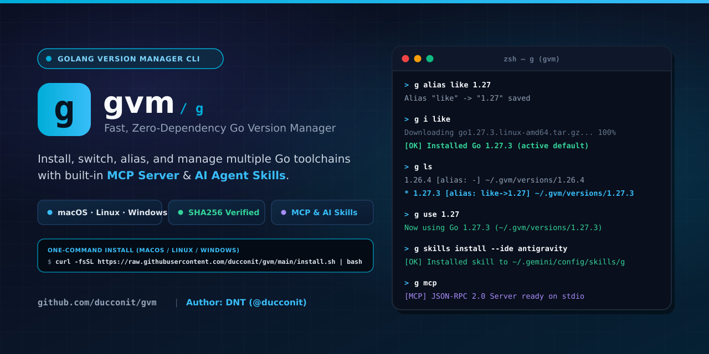

<div align="center">



# `g` (`gvm`) — Cross-Platform Golang Version Manager

**Fast, zero-dependency CLI to install, switch, alias, and manage multiple Go versions across macOS (`darwin`), Linux (`linux`), and Windows (`windows`) — with a built-in Model Context Protocol (`MCP`) Server & AI Agent Skills installer.**

[](https://github.com/ducconit/gvm/releases)
[](https://github.com/ducconit/gvm/actions)
[](https://goreportcard.com/report/github.com/ducconit/gvm)
[](https://github.com/ducconit/gvm)
[](./LICENSE)

[English](#-one-command-installation--cài-đặt-bằng-1-lệnh-duy-nhất) •
[Tiếng Việt](#-hướng-dẫn-các-lệnh-cli--command-reference) •
[MCP Server](#-mcp-server-integration-g-mcp) •
[AI Agent Skills](#-ai-agent-skills-g-skills-install) •
[Contributing](#-contributing--đóng-góp)

</div>

---

## ✨ Highlights / Điểm nổi bật

- 🌍 **Multi-OS & Multi-Arch**: Hỗ trợ đầy đủ **macOS (`darwin`)**, **Linux (`linux`)** và **Windows (`windows`)** trên cả `amd64`, `arm64`, `386`, `armv6l`.
- 🔒 **SHA256 Checksum & Safe Extraction**: Tự động đối chiếu mã băm `SHA256` từ `https://go.dev/dl/` và bảo vệ chống lỗ hổng **Tar-Slip / Zip-Slip** khi giải nén.
- 🏷️ **Smart Version & Alias Resolution**: Đặt alias ưa thích (`g alias like 1.27`), cài đặt hoặc chuyển đổi nhanh qua alias (`g i like`, `g use like`) hoặc tiền tố nhánh (`1.27` $\rightarrow$ tự động chọn bản vá mới nhất `1.27.x`).
- 🤖 **Built-in MCP Server (`g mcp`)**: Tích hợp sẵn máy chủ **Model Context Protocol (JSON-RPC 2.0 over stdio)** giúp các AI Agent / IDE tự động kiểm tra và quản lý phiên bản Go.
- 🧠 **One-Command Agent Skills (`g skills install`)**: Cài đặt trực tiếp bộ `SKILL.md` chuẩn hóa cho **Antigravity (`--ide antigravity`)**, **Claude Code**, **Cursor**, **Codex**, **OpenCode**, **Windsurf**, hoặc thư mục tùy chỉnh (`--path`).
- 🔄 **Self-Update & Clean Self-Uninstall**: Tự nâng cấp CLI chỉ với `g update` / `g update <version>` hoặc gỡ cài đặt sạch sẽ với `g uninstall`.

---

## 🚀 One-Command Installation / Cài đặt bằng 1 lệnh duy nhất

### 🍎 macOS & 🐧 Linux (Bash / Zsh)

```bash
curl -fsSL https://raw.githubusercontent.com/ducconit/gvm/main/install.sh | bash
```

*(Tuỳ chọn cài một phiên bản `g` cố định / Install a specific CLI version)*:
```bash
curl -fsSL https://raw.githubusercontent.com/ducconit/gvm/main/install.sh | GVM_VERSION=v1.0.0 bash
```

### 🪟 Windows (PowerShell)

```powershell
irm https://raw.githubusercontent.com/ducconit/gvm/main/install.ps1 | iex
```

### 📦 Cài qua `go install` (Nếu máy đã có sẵn Go)

```bash
go install github.com/ducconit/gvm/cmd/g@latest
```

---

## 📖 Hướng dẫn các lệnh CLI / Command Reference

| Command | Mô tả (Tiếng Việt) | Description (English) |
| :--- | :--- | :--- |
| `g install <version>`<br>`g i <version>` | Cài phiên bản Golang chỉ định (`1.27.3`, `1.27`, `latest` hoặc tên `alias`). | Install a specified Go version, minor series prefix, or alias. |
| `g alias <name> <version>` | Đặt alias ưa thích (VD: `g alias like 1.27`: `like` là tên alias, `1.27` là phiên bản). | Create or update a favorite version alias. |
| `g update` | Tự động cập nhật CLI `g` lên phiên bản mới nhất từ GitHub Releases. | Self-update the `g` CLI to the latest release. |
| `g update <version>` | Cập nhật CLI `g` thành một phiên bản chỉ định (VD: `g update 1.0.0`). | Self-update the `g` CLI to a specific release version. |
| `g -v` / `g version` | Xem thông tin phiên bản CLI `g` và phiên bản Go đang được sử dụng. | Display `g` CLI version and active Go toolchain version. |
| `g ls` | Liệt kê danh sách phiên bản Go đã cài kèm trạng thái active (`*`), alias và thư mục chứa. | List locally installed Go versions with aliases and paths. |
| `g ls -r`<br>`g ls --remote` | Xem danh sách phiên bản Go đang phát hành chính thức từ `go.dev/dl` (thêm `--all` để xem cả bản RC/beta). | List official remote Go releases from `go.dev/dl`. |
| `g uninstall <version>` | Xoá phiên bản Golang chỉ định (theo version cụ thể hoặc alias). | Uninstall a specified Go version or alias. |
| `g uninstall --all` | Xoá tất cả phiên bản Go đã cài **trừ** phiên bản đang được sử dụng. | Uninstall all installed Go versions **except** the currently active one. |
| `g uninstall` | Xoá chính CLI `g` và dọn sạch thư mục `$GVM_HOME`. | Self-uninstall the `g` CLI binary and `$GVM_HOME` directory. |
| `g use <version>` | Chỉ định 1 phiên bản Golang làm mặc định (theo version cụ thể hoặc alias). | Switch the default Go version by version or alias. |
| `g env` | Hiển thị các biến môi trường đang sử dụng (`GVM_HOME`, `GOROOT`, `GOPATH`, `GOBIN`, `PATH`). | Show active Go environment variables and shell export snippet. |
| `g mcp` | Chạy Model Context Protocol (MCP) server qua `stdio`. | Start the built-in MCP server over `stdio`. |
| `g skills install` | Cài đặt Skills cho AI Agent (`--path` chỉ định thư mục, mặc định `~/.agents/skills`, hoặc `--ide`). | Install AI agent skills (`--path` or `--ide antigravity`). |
| `g -h` / `g --help`<br>`g help` | Hiển thị hướng dẫn trợ giúp chi tiết. | Show CLI help and subcommand usage. |

---

## 💻 Ví dụ sử dụng nhanh / Quick Walkthrough

```bash
# 1. Đặt alias ưa thích "like" trỏ tới nhánh Go 1.27
g alias like 1.27

# 2. Cài đặt Go thông qua alias hoặc phiên bản cụ thể
g i like
g install 1.26.4

# 3. Liệt kê các phiên bản đã cài (kèm alias và đường dẫn)
g ls
# Installed Go versions (in /home/user/.gvm/versions):
#   1.26.4      [alias: -]           /home/user/.gvm/versions/1.26.4
# * 1.27.3      [alias: like->1.27]  /home/user/.gvm/versions/1.27.3

# 4. Xem danh sách các phiên bản Go chính thức từ go.dev/dl
g ls -r

# 5. Chuyển đổi phiên bản Go mặc định bằng version hoặc alias
g use 1.26.4
g use like

# 6. Kiểm tra thông tin CLI & biến môi trường
g -v
g env

# 7. Xoá tất cả phiên bản cũ, chỉ giữ lại phiên bản đang dùng
g uninstall --all
```

---

## 🧠 AI Agent Skills (`g skills install`)

Cài đặt nhanh bộ kỹ năng (`SKILL.md`) để các AI Coding Agent hiểu và sử dụng thành thạo `g`:

```bash
# Mặc định cài vào ~/.agents/skills/g
g skills install

# Chỉ định nhanh theo IDE (--ide):
g skills install --ide antigravity   # -> ~/.gemini/config/skills/g
g skills install --ide claude        # -> ~/.claude/skills/g
g skills install --ide cursor        # -> ~/.cursor/skills/g
g skills install --ide codex         # -> ~/.codex/skills/g
g skills install --ide opencode      # -> ~/.config/opencode/skills/g
g skills install --ide windsurf      # -> ~/.codeium/windsurf/skills/g

# Hoặc chỉ định thư mục bất kỳ (--path):
g skills install --path /custom/path/to/skills
```

---

## ⚡ MCP Server Integration (`g mcp`)

`g` tích hợp sẵn **Model Context Protocol (`MCP`) Server** chuẩn `JSON-RPC 2.0` qua `stdio`. Thêm cấu hình sau vào IDE hoặc AI Agent của bạn (Antigravity, Claude Desktop, Cursor, v.v.):

```json
{
  "mcpServers": {
    "gvm": {
      "command": "g",
      "args": ["mcp"]
    }
  }
}
```

### Danh sách MCP Tools hỗ trợ:
- `g_version`: Xem phiên bản CLI `g` và phiên bản Go đang kích hoạt.
- `g_env`: Xem cấu hình `GVM_HOME`, `GOROOT`, `GOPATH`, `GOBIN`, `GOOS`, `GOARCH`.
- `g_list_installed`: Liệt kê các phiên bản Go đã cài kèm alias và thư mục chứa.
- `g_list_remote`: Truy vấn danh sách release chính thức từ `go.dev/dl`.
- `g_install`: Cài đặt phiên bản Go mới hoặc qua alias.
- `g_use`: Chuyển đổi phiên bản Go mặc định.
- `g_alias`: Tạo hoặc cập nhật alias.
- `g_uninstall_version`: Xoá phiên bản chỉ định hoặc xoá tất cả trừ phiên bản đang dùng (`all: true`).

---

## 🤝 Contributing / Đóng góp

Mọi đóng góp (Bug Report, Feature Request, Pull Request) đều rất được hoan nghênh!  
Vui lòng đọc hướng dẫn chi tiết tại **[CONTRIBUTING.md](./CONTRIBUTING.md)** trước khi gửi Pull Request.

1. Fork repository [`github.com/ducconit/gvm`](https://github.com/ducconit/gvm)
2. Tạo nhánh tính năng: `git checkout -b feat/amazing-feature`
3. Chạy kiểm thử: `make vet test`
4. Mở Pull Request hoặc tạo Issue mới tại [GitHub Issues](https://github.com/ducconit/gvm/issues).

---

## 👤 Author / Tác giả

- **DNT (`@ducconit`)**
- GitHub: [@ducconit](https://github.com/ducconit)
- Email: [ducconit@gmail.com](mailto:ducconit@gmail.com)
- Organization: `@sphotontechnology`

---

## 📄 License

Distributed under the **MIT License**. See [`LICENSE`](./LICENSE) for more information.
